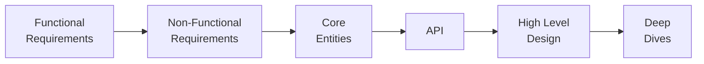

# System Design: High Level Design (HLD) Notes

My HLD notes for interview prep. Every system follows the same framework, so each page can be revised the same way.

## Systems

| # | System | Key concepts | Diagrams |
|---|--------|--------------|----------|
| 1 | [URL Shortener](./url-shortener/README.md) | Base62 + global counter, 302 vs 301, Redis cache, CDN, read/write split | HLD, Deep Dive |
| 2 | [Rate Limiter](./rate-limiter/README.md) | Token bucket, sliding window, Redis sharding, fail-open vs fail-closed, ZooKeeper rules | HLD, Deep Dive |
| 3 | [Ticketmaster / BookMyShow](./ticketmaster/README.md) | Strong consistency for booking, ticket lock with TTL, Elasticsearch + CDC, virtual waiting queue | HLD, Deep Dive |
| 4 | [Uber](./uber/README.md) | Redis geospatial, adaptive location updates, distributed lock for matching, Kafka, Temporal | HLD |
| 5 | [Notification System](./notification-system/README.md) | Kafka critical vs promotional lanes, at-least-once delivery, retries + DLQ, circuit breaker, fanout | HLD, Deep Dive |
| 6 | Google Drive | _Coming soon_ | – |
| 7 | Instagram Feed | _Coming soon_ | – |

> **Diagrams:** each page shows its diagrams as Mermaid, which GitHub displays directly. The original draw.io files are in each system's `diagrams/` folder. Use the **"Open in draw.io"** links to see or edit the full original diagram.

---

## Roadmap to solve any HLD question

### 1. Functional Requirements
- The core features of the system.
- Call out what is **out of scope** explicitly.

### 2. Non-Functional Requirements
- Qualities of the system, not features.
- Think about the **CAP theorem**: choose between consistency and availability, and it can differ per feature.
- Read vs. write frequency.
- Scalability (DAU, QPS, storage).
- Latency targets.

### 3. Core Entities
- All the important entities/classes of the system.

### 4. API
- List every API endpoint (with its HTTP method) for every functional requirement.
- **GET** APIs: keep query and params in the endpoint.
- **POST / PUT** APIs: write out the body structure.

### 5. High Level Design
- Client
- API Gateway
- Service layer
- Database layer
- Redis / cron

Go through the functional requirements one by one and satisfy each one with the design.

### 6. Deep Dives
Use these to satisfy the non-functional requirements:
- Elasticsearch (search)
- CDN
- CDC (Change Data Capture)
- Queue (Kafka / SQS)
- Load balancer
- Horizontal scaling
- Sharding
- Redis (cache, locks, counters)
