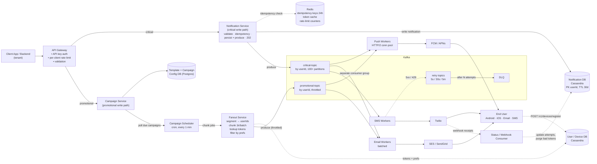
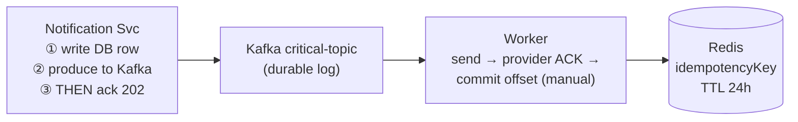
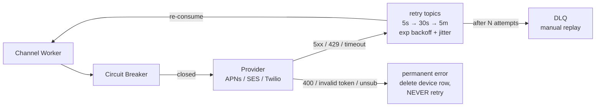
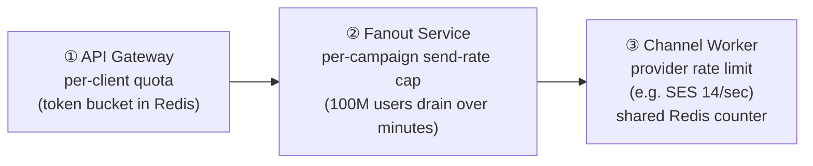
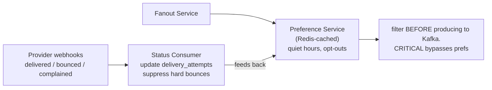

# Notification System

[⬅ Back to index](../README.md)

**Diagrams:** [Open HLD in draw.io](https://app.diagrams.net/#Uhttps%3A%2F%2Fraw.githubusercontent.com%2FRavindra230105%2Fsystem-design-hld%2Fmain%2Fnotification-system%2Fdiagrams%2Fhld.drawio) · [Open Deep Dive in draw.io](https://app.diagrams.net/#Uhttps%3A%2F%2Fraw.githubusercontent.com%2FRavindra230105%2Fsystem-design-hld%2Fmain%2Fnotification-system%2Fdiagrams%2Fdeep-dive.drawio)

---

## 1. Functional Requirements

- Clients can send **critical notifications instantly**.
- Clients can set up **promotional notifications** for many users.
- Notifications can go to **any end-user device** (Android, iOS, Email, SMS).

**Out of scope**
- Template authoring UI / campaign builder
- Analytics dashboards (open rate, CTR)
- In-app notification inbox (read/unread state)
- User preferences & quiet hours (covered only in the deep dives)

## 2. Non-Functional Requirements

- Critical notifications delivered in **< 5 sec**.
- **At-least-once delivery** for critical notifications.
- Scale to **800K critical + 200K promotional notifications/sec**.

**Out of scope:** GDPR / data residency, CI/CD, monitoring/logging/alerting.

## 3. Core Entities

| Entity | Description |
|---|---|
| **Client (Sender)** | Tenant/app calling our API (e.g. a banking app sending OTPs). Has an API key, a quota and a priority tier. |
| **User (Recipient)** | End user receiving the notification. `userId` + contact handles: device tokens, email, phone. |
| **Device** | One row per `(userId, platform, token)`; a user can have many. `platform = ANDROID \| IOS \| EMAIL \| SMS`, plus token/address and last-seen time. |
| **Notification** | One message to one user on one channel. `notificationId, clientId, userId, channel, priority (CRITICAL \| PROMOTIONAL), payload, status, createdAt` |
| **Campaign** | Promotional send to a segment at a scheduled time. `campaignId, clientId, segmentQuery, templateId, scheduledAt, status` |
| **Template** | Reusable message body with placeholders, versioned per channel. |
| **DeliveryAttempt** | Per-attempt record: `notificationId, provider (APNs/FCM/SES/Twilio), attemptNo, status (SENT \| FAILED \| RETRY), providerMessageId, error, timestamp`. Gives at-least-once tracking + retry state. |

## 4. API

All endpoints are authenticated with the client's API key (`Authorization` header).

| # | Endpoint | Returns |
|---|---|---|
| 1 | `POST /v1/notifications` | `202 { notificationId, status: "ACCEPTED" }` |
| 2 | `POST /v1/notifications/bulk` | `202 { batchId, accepted, rejected }` |
| 3 | `POST /v1/campaigns` | `{ campaignId, status: "SCHEDULED" }` |
| 4 | `GET /v1/campaigns/:campaignId` | `{ campaignId, status, sent, failed, pending }` |
| 5 | `DELETE /v1/campaigns/:campaignId` | `200`, cancels a scheduled campaign |
| 6 | `GET /v1/notifications/:notificationId` | `{ status, attempts: [DeliveryAttempt] }` |
| 7 | `POST /v1/devices/register` | `200`, called by the SDK on install / token refresh |
| 8 | `DELETE /v1/devices` | `200`, unregisters a token |
| 9 | `POST /v1/webhooks/provider/:provider` | `200`, delivery receipts + bounces from APNs/FCM/SES/Twilio |

```http
POST /v1/notifications
{
  "userId": "...",
  "channels": ["PUSH", "EMAIL", "SMS"],
  "priority": "CRITICAL",
  "templateId": "...",
  "data": { ... },
  "idempotencyKey": "..."     // client-supplied, dedupes retries
}
```

```http
POST /v1/notifications/bulk
{ "notifications": [ {...}, {...} ] }     // up to N per call
```

```http
POST /v1/campaigns
{
  "name": "...",
  "segmentQuery": { "country": "IN", "lastActiveDays": 30 },
  "templateId": "...",
  "channels": ["PUSH", "EMAIL"],
  "scheduledAt": "..."
}
```

```http
POST /v1/devices/register        { "userId": "...", "platform": "...", "token": "..." }
DELETE /v1/devices               { "userId": "...", "token": "..." }
```

## 5. High Level Design



> **Critical path (< 5 s):** Client → Gateway → Notification Service → critical-topic → worker → provider.
> Every worker: retry + backoff, circuit breaker, and offsets committed **only after the provider ACKs**.

### FR1: Send critical notifications instantly
1. Client calls `POST /v1/notifications` with `priority = CRITICAL`.
2. API Gateway authenticates the API key and applies the client's rate limit.
3. Notification Service:
   1. validates the payload + template
   2. checks **Redis for the `idempotencyKey`**: if it's been seen, return the existing `notificationId` (so client retries can't create duplicate OTPs)
   3. writes the Notification row with `status = ACCEPTED`
   4. produces the message to the **Kafka critical topic**
   5. returns **202** right away (does **not** wait for the provider)
- The synchronous path is just a Redis lookup + one Kafka produce, so the API responds in a few ms. The **async pipeline owns the 5 s SLA**.

**Why use a queue at all?**
- Third-party providers are slow and sometimes down. Calling them inline would block the client, and a provider outage would take our API down with it.
- Kafka gives the **durability** at-least-once needs: the message is persisted **before** we ack the client.

**Why separate topics for critical and promotional?**
- A 200K/sec promotional campaign must never sit in front of an OTP in the same queue (**head-of-line blocking**). Separate topics + separate worker pools mean a huge campaign can't delay a critical notification.

### FR2: Promotional notifications to many users
1. Client calls `POST /v1/campaigns` with a `segmentQuery` and `scheduledAt`.
2. Campaign Service stores it in Postgres with `status = SCHEDULED`.
3. **Campaign Scheduler** (cron, every minute) picks up due campaigns and hands them to the **Fanout Service**.
4. Fanout Service:
   1. resolves the segment into userIds (paginated scan / precomputed segment)
   2. splits them into batches (e.g. 1000 users)
   3. for each batch, looks up device tokens and produces to the **promotional topic**
   - Fanout itself scales horizontally: the scheduler pushes **chunk jobs** onto a work queue so many fanout workers share one campaign.
5. Channel workers consume the promotional topic at a **throttled** rate.

**Why is fanout a separate service?** One campaign can expand to **100M notifications**. Doing that inside the request path or the scheduler would make one node the bottleneck and a single point of failure. Splitting into chunks and distributing them makes it **restartable and parallel**.

### FR3: Any device (Android, iOS, Email, SMS)
- The SDK registers tokens via `POST /v1/devices/register`. One row per `(userId, platform, token)`, so a phone + tablet + email all get it.
- **One worker pool per channel**, because each channel behaves very differently:

| Channel | Provider | Characteristics |
|---|---|---|
| Push (Android) | FCM | HTTP/2, batch send (up to 500 tokens) |
| Push (iOS) | APNs | HTTP/2 persistent connections, one token per request |
| Email | SES / SendGrid | Batchable, slow, needs bounce handling |
| SMS | Twilio | Expensive, low throughput, country-specific rules |

- A **Channel Adapter interface** hides these differences, so adding WhatsApp later means a new adapter, not a new pipeline.
- **Fan-out per channel:** `channels: ["PUSH","EMAIL"]` becomes 2 Notification rows + 2 queue messages, so one failing channel doesn't block the other.

## 6. Deep Dives

### 1. At-least-once delivery for critical notifications



- **Persist before ack:** the DB row is written and the Kafka produce is acked **before** we return 202. If we crash after that, the message is still in Kafka.
- **Manual offset commit:** workers commit the offset **only after the provider returns success**. If a worker dies mid-send, the partition is reassigned and the message is **re-delivered**.
- 🔑 At-least-once means **duplicates are possible**. Dedupe with the `idempotencyKey` in Redis (TTL ~24 h) and pass a **collapse-id / message-id** to APNs/FCM so the device drops duplicates. **End-to-end exactly-once isn't possible when the last hop is a third party.**

### 2. Provider failure or rate limiting



- Separate **retryable** errors (5xx, 429, timeout) from **permanent** ones (400, invalid token, unsubscribed). An invalid FCM token → delete the device row.
- Retries go onto **delay topics** (retry-5s, retry-30s, retry-5m) instead of sleeping in the worker, so worker threads are never blocked.
- After N attempts → **DLQ** for inspection / manual replay.
- 🔑 Wrap each provider in a **Circuit Breaker**: if APNs keeps failing for 30 s, open the circuit, stop sending to it, and let messages queue up instead of burning the whole worker pool on timeouts.

### 3. Hitting the < 5 s SLA

| 🚨 Critical lane | 📣 Promotional lane |
|---|---|
| critical-topic → dedicated consumer group | promotional-topic → its own consumer group |
| **Over-provisioned** worker pool | **Throttled** worker pool, deliberately rate-capped |
| Persistent **HTTP/2** connections to APNs/FCM | |
| Device tokens **cached in Redis** (no DB on hot path) | |

- **Latency budget:** API ~10 ms → queue lag < 1 s → worker + provider ~1–2 s → headroom.
- 🔑 The SLA is a **queue-lag problem, not a code problem**. Alert on and **autoscale by consumer lag** of the critical topic, not by CPU. (A TLS handshake per notification would use up the budget on its own.)

### 4. Scaling to 800K critical + 200K promotional/sec

- **Kafka:** partition by `hash(userId)`. At ~10K msg/sec per partition, 1M/sec needs **100+ partitions** per topic across a multi-broker cluster.
- **Workers:** one consumer per partition, **stateless**, scaled horizontally.
- **Storage split:**
  - `notifications` + `delivery_attempts` → **Cassandra/DynamoDB**, PK `userId`, TTL 30 d (append-only, write-heavy, time-series)
  - templates + campaign config → **Postgres** (low volume, relational)
- **Geographic sharding:** route users to their nearest region, which also cuts RTT to regional provider endpoints.
- 🔑 **Partition key = userId** keeps each user's notifications in order ("new message" can't arrive before "message deleted").

### 5. Stopping a bad campaign from taking down the system: multi-level throttling



- 🔑 **Noisy-neighbour isolation:** without per-tenant quotas, one client's campaign takes over the shared worker pool and quietly breaks every other client's SLA.

### 6 & 7. Preferences / quiet hours + delivery status feedback loop



**Preferences, quiet hours, unsubscribes**
- Check them in a **Preference Service during fanout, not at send time**. Filter the audience **before** producing to Kafka, so we never pay to queue messages we'll drop.
- **Critical** (OTP, fraud, security) **bypasses** preferences and quiet hours; promotional doesn't. This is a **legal requirement** in many places.
- Bounce/complaint webhooks feed back into the preference store, so a hard bounce or spam complaint automatically suppresses that address.
- 🔑 **Cache preferences in Redis**: fanout checks them millions of times per campaign.

**Did the notification actually arrive?**
- The worker sets `status = SENT` when the provider **accepts** the message. That means "handed off", not "delivered".
- Providers call `POST /v1/webhooks/provider/:provider` with delivered/open/bounce receipts → **Status Consumer** updates `DeliveryAttempt` asynchronously.
- `GET /v1/notifications/:id` shows the full attempt history.
- 🔑 Push is **best-effort by design**: APNs/FCM never confirm the user saw it. Only expose what the provider reports.

### 8. Ordering and duplicate notifications on the device
- Kafka keeps order **within a partition**, so **keying by userId** keeps each user's notifications in order.
- Use **FCM `collapse_key` / APNs `apns-collapse-id`** so 5 updates to the same chat thread show as one notification, not 5.
- 🔑 **Global ordering** is neither achievable nor needed; **per-user ordering** is what the user actually notices.

---

### 🧠 Quick Revision
- Persist → Kafka → **202**; workers commit offset only after provider ACK = **at-least-once**; dedupe with idempotencyKey + collapse-id.
- **Separate critical vs promotional lanes** (topics, consumer groups, pools) → no head-of-line blocking.
- Retry topics + jitter → DLQ; circuit breaker per provider; never retry permanent errors.
- Partition by **userId** → scale + per-user ordering. Cassandra for notifications, Postgres for config.
- Throttle at three levels: gateway, fanout, provider.
- SLA = consumer lag → autoscale on lag.
