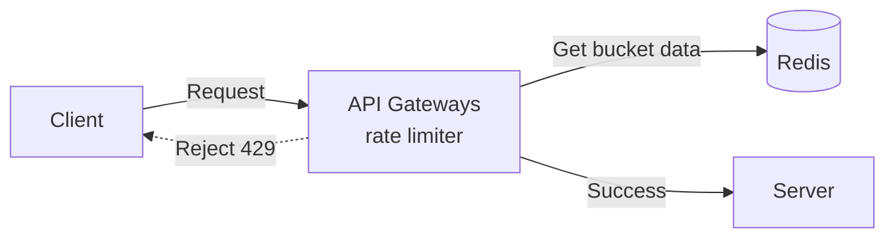
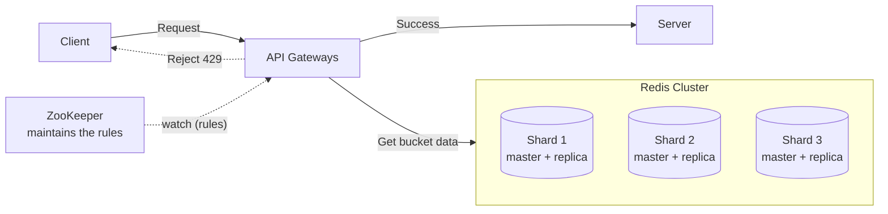

# Rate Limiter

[⬅ Back to index](../README.md)

**Diagrams:** [Open HLD in draw.io](https://app.diagrams.net/#Uhttps%3A%2F%2Fraw.githubusercontent.com%2FRavindra230105%2Fsystem-design-hld%2Fmain%2Frate-limiter%2Fdiagrams%2Fhld.drawio) · [Open Deep Dive in draw.io](https://app.diagrams.net/#Uhttps%3A%2F%2Fraw.githubusercontent.com%2FRavindra230105%2Fsystem-design-hld%2Fmain%2Frate-limiter%2Fdiagrams%2Fdeep-dive.drawio) · [Drive: HLD](https://drive.google.com/file/d/134DXinXXo_yk6uexfKQXiCK9Pip8xKFv/view?usp=sharing) · [Drive: Deep Dive](https://drive.google.com/file/d/14s7UqgTNjm10322SQ_4u1FCHEc3sy7Js/view?usp=sharing)

---

## 1. Functional Requirements

- Identify clients by **user ID, IP address, or API key** so the right limits apply.
- Limit HTTP requests using **configurable rules** (e.g. 100 API requests per minute per user).
- When a limit is exceeded, reject the request with **HTTP 429** and helpful headers (requests remaining, reset time).

## 2. Non-Functional Requirements

- **Low latency:** < 10 ms overhead per request check.
- **Highly available.**
- **Eventual consistency is OK:** small delays in enforcing limits across nodes are acceptable.
- **Scale:** 1M requests/second across 100M DAU.

## 3. Core Entities

| Entity | Description |
|---|---|
| **Rules** | Rate-limiting policies: requests per time window, which clients they apply to, which endpoints they cover. e.g. _"authenticated users get 1000 req/hour"_, _"search API allows 10 req/min per IP"_. |
| **Clients** | What gets rate limited: users (user ID), IP addresses, API keys, or combinations. |
| **Requests** | Incoming API requests checked against the rules. |

When a **Request** arrives → identify the **Client** → look up the applicable **Rules** → allow or reject.

## 4. High Level Design



### FR1: Where does the rate limiter live, and how are clients identified?

| | Approach | Challenge |
|---|---|---|
| ❌ **Bad: In-process** | Rate limiter inside each app server, counters in local memory | Each server sees only its own traffic, so limits aren't global. With 5 servers a user gets ~5× the limit. |
| 🟡 **Good: Dedicated rate limiter service** | Separate service that every app server calls before handling a request; holds central state | Adds a network hop and latency. One more service that must be highly available. |
| ✅ **Great: API Gateway / Load Balancer** | Rate limit directly at the gateway/LB, before requests reach app servers | Gateway has little business context. Still needs a fast shared store like **Redis**. |

**How do we identify clients?** With the gateway approach we can only use what's in the HTTP request: URL/path, headers (`Authorization`, `User-Agent`, `X-API-Key`, …), query params, and client IP.

| Key | Best for |
|---|---|
| **User ID** | Authenticated APIs |
| **IP address** | Public APIs / no user accounts |
| **API key** | Developer APIs |

Types of limits:
- **Per-user:** "Alice can make 1000 requests/hour"
- **Per-IP:** "This IP can make 100 requests/minute"
- **Global:** "Our API handles 50,000 requests/second in total"
- **Endpoint-specific:** "Search is limited to 10/min, profile updates to 100/min"

### FR2: Limit requests with configurable rules (algorithms)

| Algorithm | Approach | Challenge |
|---|---|---|
| **Fixed Window Counter** | Split time into fixed windows (e.g. 100 req/min), one counter per client | **Boundary problem:** 100 requests at 12:00:59 + 100 more at 12:01:00 |
| **Sliding Window Log** | Store the timestamp of every request; count the ones in the last N sec/min | Very accurate but **memory-heavy** (every timestamp stored) |
| **Sliding Window Counter** | Counters for current + previous window, weighted to approximate a sliding count | Low memory but **approximate**, and the math is more complex |
| **Token Bucket** ✅ | Bucket of tokens refilled at a fixed rate; each request uses one token | Picking the right bucket size + refill rate; burst/cold-start behaviour |

### FR3: Reject with HTTP 429 + helpful headers
`429 Too Many Requests` is the standard HTTP status code for this. Include headers like:

```http
HTTP/1.1 429 Too Many Requests
X-RateLimit-Limit: 100
X-RateLimit-Remaining: 0
X-RateLimit-Reset: 1700000000
Retry-After: 30
```

## 5. Deep Dives



### 1. How do we scale to 1M requests/sec?
- **Approach:** shard Redis by userId / IP / API key so requests spread across many Redis nodes. Use **Redis Cluster** in production.
- **Key point:** a given client's requests must always reach the **same shard**, via **consistent hashing / Redis hash slots**.

### 2. How do we ensure high availability and fault tolerance?
- **Approach:** Redis **master-replica replication + automatic failover**.
- **Key point:** decide **fail-open vs fail-closed** for when Redis is down. The choice depends on the system's requirements.

### 3. How do we keep latency low?
- **Approach:** keep **persistent Redis connections (connection pooling)** and deploy gateways/Redis **close to users**.
- **Key point:** don't open a new TCP connection per request. Multi-region deployment cuts network latency.

### 4. How do we handle hot keys?
- **Legitimate high-volume clients:** client-side limiting, batching, premium tiers.
- **Abuse:** temporary blocking + DDoS protection.
- **Key point:** one user/IP sending huge traffic can overload a single Redis shard, so treat legitimate and abusive hot keys differently.

### 5. How do we handle dynamic rule configuration?
| | Approach | Trade-off |
|---|---|---|
| Good | Gateways **poll** a config DB/service periodically | Simple, but changes take time to propagate |
| Great | **Push-based** config via **ZooKeeper / Redis Pub/Sub** | Near-instant updates, but much more complexity |

---

### 🧠 Quick Revision
- Put it at the **API Gateway** with **Redis** as shared state.
- **Token bucket** is the go-to algorithm; know the fixed window boundary problem.
- Shard Redis (consistent hashing) → 1M rps. Replicas + failover → HA. Decide fail-open vs fail-closed.
- Rules pushed via ZooKeeper / PubSub.
