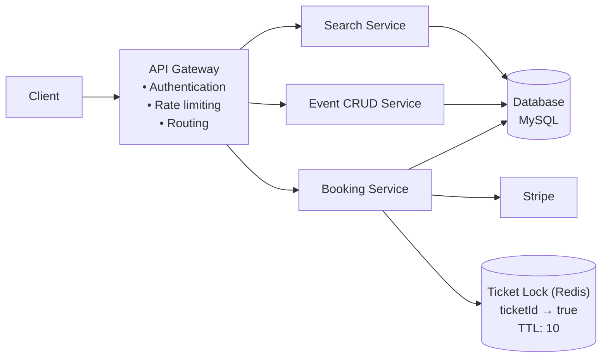
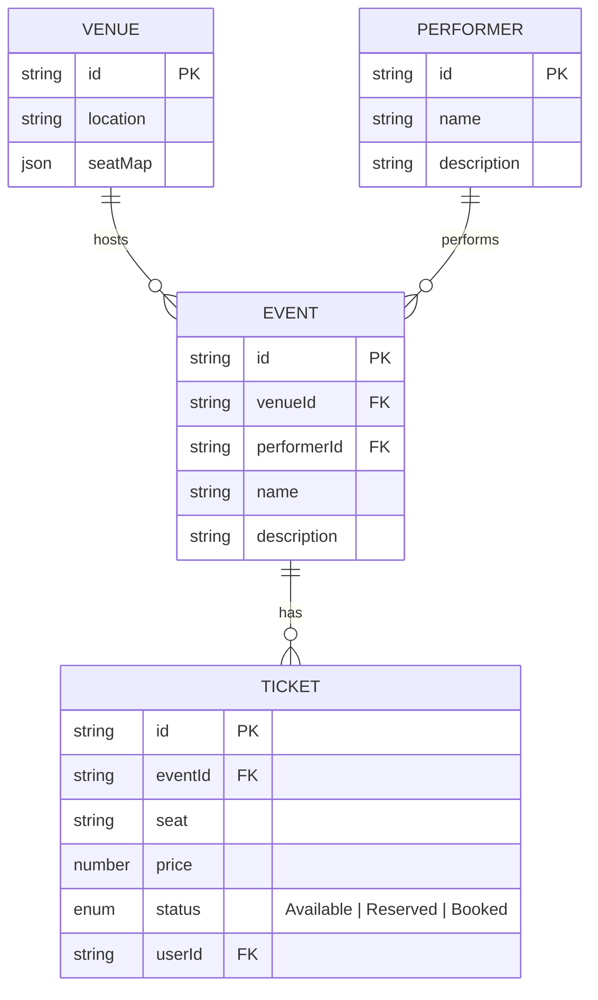
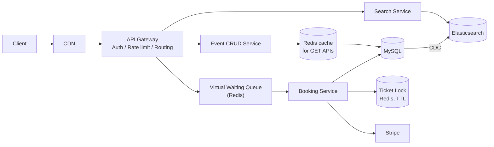

# Ticketmaster (BookMyShow)

[⬅ Back to index](../README.md)

**Diagrams:** [Open HLD in draw.io](https://app.diagrams.net/#Uhttps%3A%2F%2Fraw.githubusercontent.com%2FRavindra230105%2Fsystem-design-hld%2Fmain%2Fticketmaster%2Fdiagrams%2Fhld.drawio) · [Open Deep Dive in draw.io](https://app.diagrams.net/#Uhttps%3A%2F%2Fraw.githubusercontent.com%2FRavindra230105%2Fsystem-design-hld%2Fmain%2Fticketmaster%2Fdiagrams%2Fdeep-dive.drawio) · [Drive: HLD](https://drive.google.com/file/d/1o40g1TYt2lDEii6bQjPcTHEygQMQQizL/view?usp=sharing) · [Drive: Deep Dive](https://drive.google.com/file/d/1B_ufQHKDGm-MB-RVu2JltdDvW13gQgyq/view?usp=sharing)

---

## 1. Functional Requirements

- Search for an event
- View an event
- Book tickets

## 2. Non-Functional Requirements

- **Low-latency search.**
- **Strong consistency for booking tickets** (no double booking).
- **High availability** for searching and viewing events.
- **Read >> Write.**
- **Scalability** to handle surges for popular events.

## 3. Core Entities

- Event
- Venue
- Performer
- Ticket

## 4. API

```http
GET /event/:eventId
```

```http
GET /search?term={term}&location={location}&type={type}&date={date}
```

```http
POST /booking/reserve
Header: JWT | sessionToken
{ "ticketId": "..." }
```

```http
PUT /booking/confirm
Header: JWT | sessionToken
{ "ticketId": "...", "paymentDetails": { ... } }
```

## 5. High Level Design



### Data model



### Booking flow (two-phase: reserve → confirm)
1. **Reserve:** `POST /booking/reserve` → Booking Service takes a **ticket lock in Redis** (`ticketId → true`, with a TTL). Other users can no longer reserve that seat.
2. **Pay:** the user pays through **Stripe**.
3. **Confirm:** `PUT /booking/confirm` → ticket `status = Booked` in MySQL (a **transaction**, which gives strong consistency), then the lock is released.
4. If the user drops off, the **TTL expires** and the seat becomes available again automatically. No cleanup cron is needed.

## 6. Deep Dives



| Deep dive | Solution |
|---|---|
| **Low-latency search** | **Elasticsearch** (full-text, geo, filters) kept in sync from MySQL via **CDC** (Change Data Capture) |
| **Fast event views (read >> write)** | **Redis cache** in front of the DB for GET APIs + **CDN** for static/popular event pages |
| **No double booking** | **Distributed ticket lock in Redis with a TTL** + DB transaction on confirm |
| **Surge for popular events** | **Virtual waiting queue (Redis)**: users wait in a queue and are let into booking in batches, so the booking service and DB aren't overloaded |
| **Read scalability** | Horizontal scaling of stateless services behind the API Gateway |

---

### 🧠 Quick Revision
- Consistency for **booking**, availability for **search/view** (CAP decided per feature).
- Reserve → lock with TTL → pay (Stripe) → confirm.
- Search = Elasticsearch + CDC. Views = Redis + CDN. Surges = virtual waiting queue.
