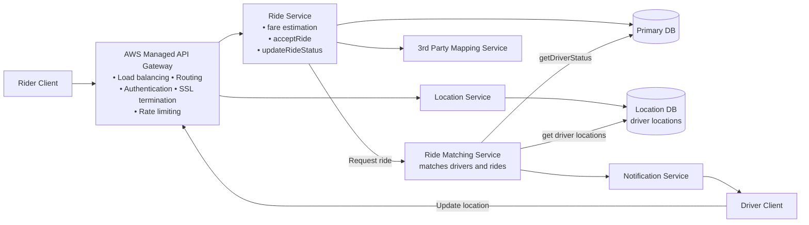
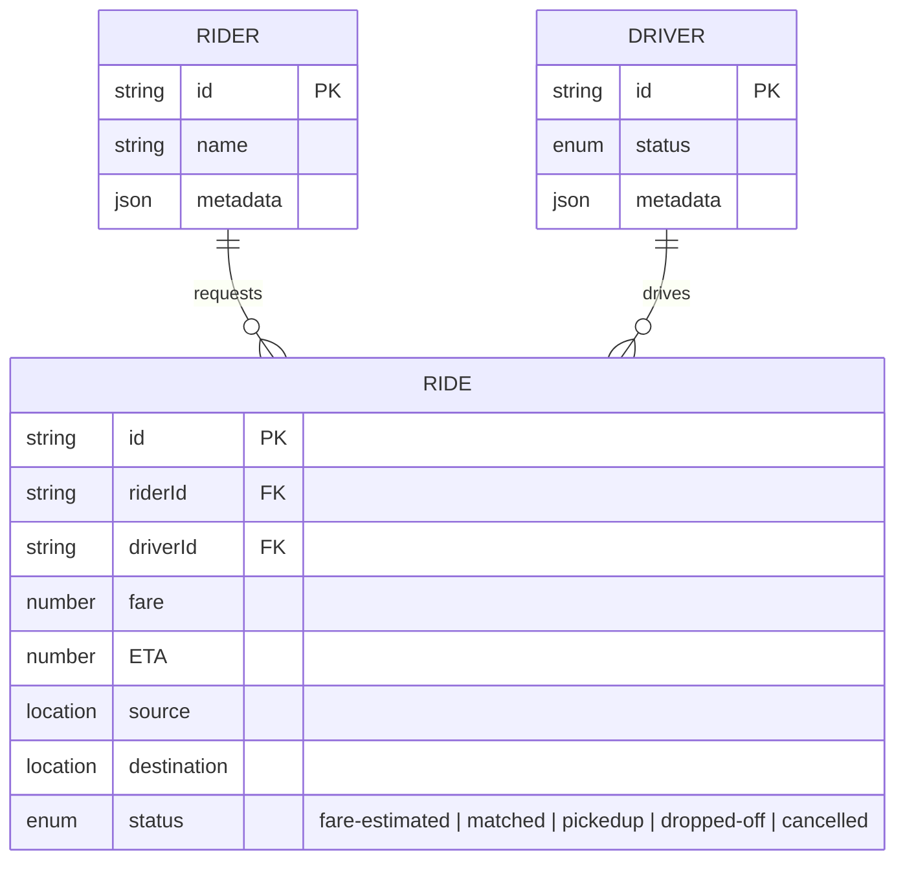

# Uber

[⬅ Back to index](../README.md)

**Diagrams:** [Open HLD in draw.io](https://app.diagrams.net/#Uhttps%3A%2F%2Fraw.githubusercontent.com%2FRavindra230105%2Fsystem-design-hld%2Fmain%2Fuber%2Fdiagrams%2Fhld.drawio) · [Drive: HLD](https://drive.google.com/file/d/18CgsK_CLoE0eCFCKz9YknqmZ--8hBbGq/view?usp=sharing)

---

## 1. Functional Requirements

- A rider enters a start location and a destination and gets an **estimated fare**.
- A rider can **request a ride** based on the estimate.
- A driver can **accept/deny** a request and **navigate** to pickup / drop-off.

**Out of scope**
- Multiple car types
- Ratings for drivers and riders
- Scheduling a ride in advance

## 2. Non-Functional Requirements

- **Low-latency matching.**
- **Consistency for driver matching** (a driver gets one ride at a time; a ride goes to one driver at a time).
- **High availability** everywhere outside the matching service.
- **High throughput**, including surges at peak hours or special events.

**Out of scope**
- GDPR / user privacy
- Resilience and handling system failures
- Monitoring, logging, alerting
- CI/CD pipeline

## 3. Core Entities

- Rider
- Driver
- Ride
- Location

## 4. API

```http
POST /ride/fare-estimate          -> returns Partial<Ride>
{ "source": {...}, "destination": {...} }
```

```http
PATCH /ride/request               -> 200 OK
{ "rideId": "..." }
```

```http
POST /location/update             (driver)
{ "lat": ..., "long": ... }
```

```http
PATCH /ride/driver/accept
{ "rideId": "...", "rideAccept": true | false }
```

```http
PATCH /ride/driver/update         -> returns lat/long for "pickedup", null for "dropped-off"
{ "rideId": "...", "status": "pickedup" | "dropped-off" }
```

## 5. High Level Design



### Data model



### Flows
1. **Fare estimate:** Rider → Ride Service → **3rd-party mapping service** (distance/ETA) → fare calculated → `Ride` saved with `status = fare-estimated` → returned to the rider.
2. **Request ride:** Rider → Ride Service → **Ride Matching Service** finds nearby drivers (Location DB) that are available (driver status) → **Notification Service** pushes the request to the driver.
3. **Driver accepts / navigates:** Driver → Ride Service (`acceptRide`, `updateRideStatus`) → ride becomes `matched` → `pickedup` → `dropped-off`.
4. **Location updates:** Driver app → Location Service → Location DB, sent periodically.

## 6. Deep Dives

### 1. Driver location updates + proximity search
10M drivers sending their location every 5 sec ≈ **2M updates/sec**, which normal DB writes can't handle well.
→ Use **Redis as an in-memory geospatial store** (`GEOADD` / `GEOSEARCH`) for real-time location updates and nearby-driver searches. **Remove stale drivers** after a timeout.

### 2. Reduce location update load
Updating every 5 sec from every driver creates unnecessary load.
→ **Adaptive update intervals** based on speed, direction, driver status and how close the driver is to a ride. Stationary/slow drivers update less often; active/moving drivers update more often.

### 3. Matching consistency
Only **one driver** should get a request for a ride at a time, and one driver shouldn't get **multiple requests** at once.
→ **Distributed lock in Redis with a TTL** (e.g. 10 sec). If the driver accepts, the lock is released into the ride. If not, the **TTL expires** and the driver becomes available again.

### 4. Peak traffic / no dropped requests
During peak hours or special events, ride requests can overload the matching service.
→ Put ride requests into a **queue (Kafka)** and process them asynchronously. **Scale matching workers on queue size**, and **partition queues geographically** if needed.

### 5. Driver doesn't respond
Give the driver a limited time (e.g. 10 sec) to accept/decline. If there's no response, **automatically try the next driver**.
→ A **delay queue** can handle the retries. For something more robust, use a **durable workflow engine like Temporal**, so retries/timeouts survive service failures.

### 6. Further scaling
→ **Horizontal scaling** with **geographic sharding** and **read replicas** to cut latency and raise throughput. Services, queues and DBs can all be partitioned by region. Only proximity searches near a region boundary may need to query more than one shard.

---

### 🧠 Quick Revision
- Redis GEO for ~2M location updates/sec; adaptive update intervals.
- Redis lock with TTL so one driver ↔ one ride.
- Kafka buffers surges; Temporal/delay queue handles driver timeouts.
- Shard by geography.
