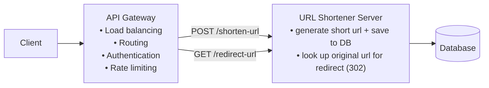
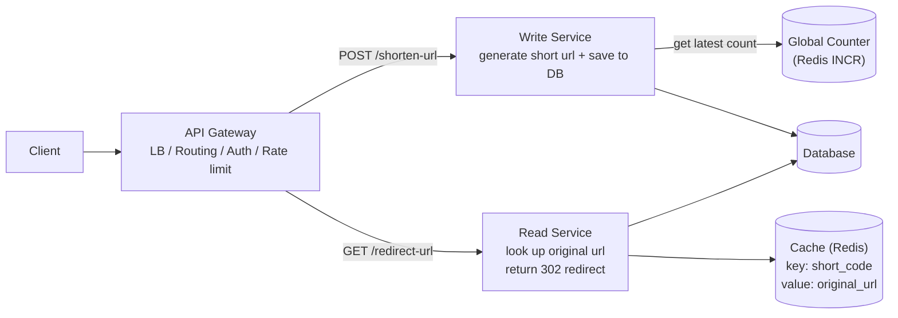

# URL Shortener

[⬅ Back to index](../README.md)

**Diagrams:** [Open HLD in draw.io](https://app.diagrams.net/#Uhttps%3A%2F%2Fraw.githubusercontent.com%2FRavindra230105%2Fsystem-design-hld%2Fmain%2Furl-shortener%2Fdiagrams%2Fhld.drawio) · [Open Deep Dive in draw.io](https://app.diagrams.net/#Uhttps%3A%2F%2Fraw.githubusercontent.com%2FRavindra230105%2Fsystem-design-hld%2Fmain%2Furl-shortener%2Fdiagrams%2Fdeep-dive.drawio) · [Drive: HLD](https://drive.google.com/file/d/1ZJglafNEOqb23_8k3m_UjtPLvmTElluu/view?usp=sharing) · [Drive: Deep Dive](https://drive.google.com/file/d/18Ded7-qpAPCemF-padxlcLiY_KwiCC9o/view?usp=sharing)

---

## 1. Functional Requirements

- Users can submit a long URL and get back a shortened version.
  - _Optional:_ users can choose a custom alias (e.g. `www.short.ly/my-custom-alias`).
  - _Optional:_ users can set an expiration date for the short URL.
- Users can reach the original URL by opening the short URL.

**Out of scope**
- User authentication and account management.
- Click analytics (click counts, geographic data).

## 2. Non-Functional Requirements

- **Uniqueness:** each short code maps to exactly one long URL.
- **Low latency:** redirects happen in **< 100 ms**.
- **Availability:** 99.99% uptime (**availability > consistency**).
- **Scale:** **1B** shortened URLs and **100M DAU**.

## 3. Core Entities

- Original URL
- Short URL
- User

## 4. API

```http
POST /shorten-url            -> returns short_url
{
  "long_url": "...",
  "custom_alias": "...",       // optional
  "expiration_date": "..."     // optional
}
```

```http
GET /redirect/:short_code    -> HTTP 302 redirect to the original long URL
```

## 5. High Level Design



**`urls` table**

| Column | Notes |
|---|---|
| `id` | PK |
| `short_url_code` | or custom alias |
| `original_url` | |
| `creation_time` | |
| `expiration_time` | |

### FR1: Submit a long URL and get a short URL
- The Primary Server receives the request and checks the long URL format (e.g. with a library like `is-url`).
- _Optional:_ if this exact long URL was already shortened, return the existing short code (deduplication).
- If the user gave a **custom alias**, use it as the short code once you've checked it doesn't already exist.
- To stop custom aliases from colliding with future counter-generated codes, **prefix generated codes** with a character that aliases can't use, or keep them in **separate namespaces**.
- Insert the short code (or alias), long URL and expiration date into the DB.
- Return the short URL to the client.

### FR2: Open the short URL and get redirected
- The browser sends `GET /abc123`.
- The server looks up `abc123` in the DB.
- If it exists and hasn't expired, return the long URL. **If it has expired, return `410 Gone`.**
- The server sends an HTTP redirect:

| Redirect | Meaning | Caching |
|---|---|---|
| **301** Permanent | Resource has moved for good | Browser **caches** it, so later requests skip our server |
| **302** Found (temporary) | Resource is temporarily elsewhere | **Not cached**, so every request comes through our server ✅ (keeps control + analytics possible) |

## 6. Deep Dives



### 1. How do we make sure short URLs are unique?
- **Increment a global counter** for every new URL, then **Base62-encode** the counter value to get a compact code.
- **Redis** suits the counter well: it's **single-threaded** and has **atomic** `INCR`, so commands run one at a time and there are no race conditions.

**Challenges**
1. In a distributed setup, a single global counter is hard to keep in sync, since every Primary Server instance must agree on the value. _(Common fix: each server takes a **batch of counter values**, e.g. 1000 at a time, so it only calls Redis once per batch.)_
2. Sequential counters give **predictable** short codes. If that matters, apply a reversible transform (e.g. **XOR with a secret key**) before Base62 encoding.

### 2. How do we make redirects fast?
| Level | Solution |
|---|---|
| Good | Add an **index** on `short_url_code` |
| Great | **In-memory cache** (Redis / Memcached) between the app server and the DB, storing hot `short_code → long_url` mappings (limited by memory) |
| Best | **CDN**: serve the short domain through a CDN with PoPs around the world, so redirects are answered close to the user |

### 3. How do we scale to 1B URLs and 100M DAU?
- **Storage:** 1B URLs × ~500 bytes = **~500 GB**, which a single Postgres instance can handle for now.
- **Reads:** 100M DAU × 5 redirects/day = 500M/day ≈ **5.8K/sec** average. With a 100× peak that's **~600K reads/sec**.
- Reads are the bottleneck, so serve most redirects from **Redis** instead of Postgres.
- **Writes** are tiny: ~100K new URLs/day ≈ **1 write/sec**, which Postgres/MySQL/DynamoDB handle easily.
- **HA:** DB replication and/or backups.
- **Separate the Read Service and the Write Service** so each scales independently.

---

### 🧠 Quick Revision
- Counter + Base62 → unique codes; Redis INCR is atomic.
- 302 over 301 → every request comes through us.
- Cache → CDN for fast reads; read-heavy (~600K rps) vs write-light (~1 wps).
- Expired → 410 Gone.
